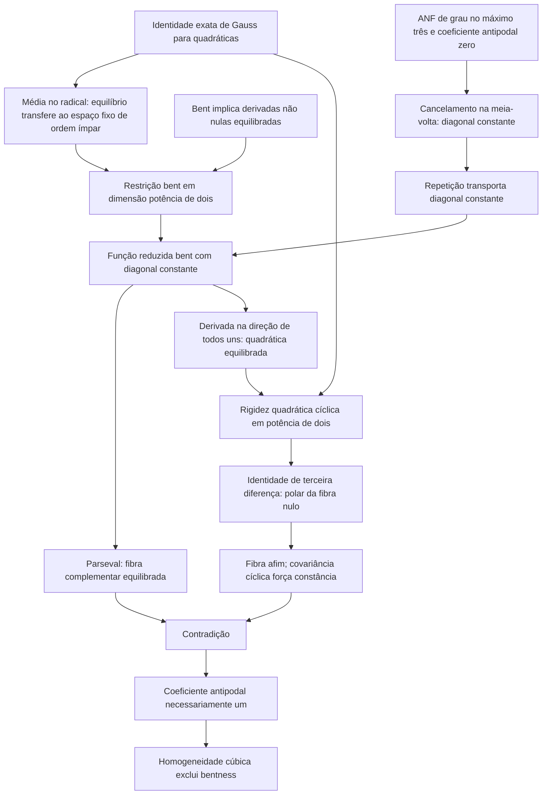

# Mapa lógico da V1 simplificada

Resultado preservado: em toda dimensão positiva par, RS + bent + grau ANF ≤3 implica coeficiente antipodal 1. Corolário: inexistência cúbica homogênea RS bent. Não há limitação módulo 32 e não há conclusão quártica.

## Inventário do artigo

| Item | Hipóteses decisivas | Conclusão | Dependências |
|---|---|---|---|
| Teorema 1 | n>0 par; grau≤3; simetria efetiva por um passo; Walsh plano | coeficiente de x0 x(n/2) igual a 1 | Corolário 4, Proposição 6 e cancelamento ANF |
| Corolário 2 | homogeneidade de grau exatamente 3 | não bent | Teorema 1; coeficientes quadráticos zero |
| Lema 3 | q quadrática; T linear invertível; T^m=I com m ímpar; invariância | equivalência de equilíbrio no espaço fixo | Gauss e média no radical |
| Corolário 4 | f grau≤3 e bent, invariância sob T | restrição bent | Lema 3 aplicado às derivadas e Fourier |
| Lema 5 | N potência de dois; quadrática RS equilibrada | polar zero | radical, nilpotência S+I, imagem de paridade e Gauss |
| Proposição 6 | N≥2 potência de dois; grau≤3; RS; diagonal constante | não bent | Lema 5, Parseval e identidade trilinear |

Numeração conferida com a versão compilada; é global no artigo. Não existe dependência circular: a rigidez quadrática precede a obstrução, a obstrução não usa o teorema universal, e a redução de ordem ímpar não assume bentness da restrição.

A identidade de transporte de coeficientes sob folding NÃO é uma aresta. As fontes formais usam outra rota para o teorema global; a edição preserva essa escolha.
