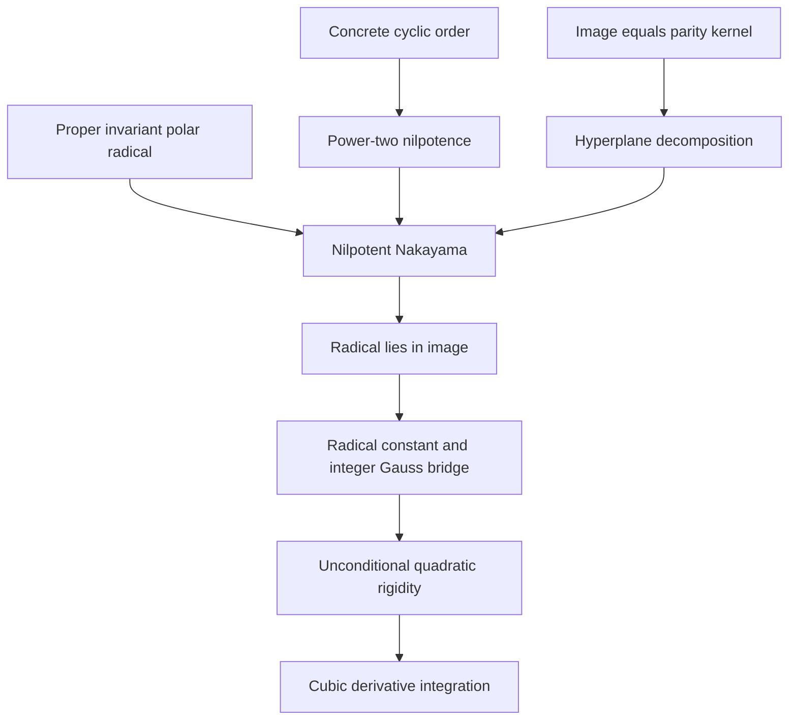

# Independent completion of quadratic Lemma 5.1

## Scope and checkpoint

Frozen parent: `8e3ddf6772e729217d839e573ea3214aa5c46880` on
`formal/antipodal-global-completion-2026-10-14`.
Work branch: `formal/astra-quadratic-rigidity-independent`.
Lean 4.15.0; Mathlib `9837ca9d65d9de6fad1ef4381750ca688774e608`.

The unconditional **quadratic rigidity statement** is proved in
`Antipodal/CyclicQuadraticRigidity.lean`. This is not a proof of the
universal cubic antipodal/nonexistence theorem.

## Exact complete final theorem signature

```lean
theorem balanced_rotation_invariant_quadratic_polar_zero
    (k : ℕ) (hk : 1 ≤ k) (Q : Vec (2^k) → F₂)
    (hq : ∀ a b c, third Q a b c = 0)
    (hs : ∀ x, Q (rotate x) = Q x)
    (hbalanced : (∑ x : Vec (2^k), sign (Q x)) = 0) :
    ∀ u v, polar Q u v = 0
```

Namespace: `HRSBF.Antipodal`. Transparent existing definitions are:

- `F₂ = ZMod 2`, `Vec n = Fin n → F₂`.
- `rotate x i = x (finRotate n i)`: the actual cyclic coordinate rotation.
- `polar Q u v = Q (u+v) + Q u + Q v + Q 0`.
- `third Q a b c = Q (a+b+c) + Q (a+b) + Q (a+c) + Q (b+c) + Q a + Q b + Q c + Q 0`.
- `sign b : ℤ = if b = 0 then 1 else -1`.

There are no implicit coefficient, normalization, radical-image, or polar-zero
hypotheses. The lower bound `hk` is retained to match the mission; the proof
actually also works at k=0, hence Lean's harmless unused-parameter warning.

## Elementary proof and independent audit

For every n, `cyclicShift n` is the linear automorphism whose underlying map
is exactly `rotate`. Its n-th power is the identity. The induction evaluates
its m-th power at i as `x (i + m)` in `Fin (n+1)`; the final cast of n+1 is zero.
The n=0 case is handled explicitly.

Define `parity n v = ∑ i, v i`. The new theorem proves the **equality of
subspaces**

```lean
LinearMap.range ((cyclicShift n).toLinearMap + 1) =
  LinearMap.ker (parity n)
```

Both inclusions are checked. For the constructive inclusion, set
`y i = ∑ j < i, v j`, implemented by a finite natural-index sum with a
bounded coordinate lookup. Interior coordinates satisfy
`y(i+1)=y(i)+v(i)`. At the last coordinate, zero total parity gives precisely
the wraparound equation. No image containment is assumed.

For n=2^k, the existing characteristic-two Frobenius lemma now gives
`(S+I)^n=0` from the proved order law. If r is outside this image, its parity
is one. For every x, the vector `x + parity(x) • r` has parity zero, producing
the required hyperplane decomposition. An S-stable radical is also stable
under S+I. The existing nilpotent Nakayama theorem therefore places every
proper radical inside this image. Properness follows from nonzero polar.

This discharges the entire `himage` premise of the previously certified
`balanced_polar_zero_of_proper_radical_image`; it is not carried into the
final signature.

The audit of the analytic step confirms the constants are essential and
present. If r=Sy+y lies in the polar radical, then
`polar Q r y = Q r + Q 0`, using rotation invariance and characteristic two.
Thus Q is constant on its radical, with value Q(0), not necessarily zero.
The Gauss identity uses `sign (Q r + Q 0)`, so every radical contribution is
+1, including when Q(0)=1. Its cardinality is positive because zero belongs
to the radical. The exact integer Walsh square cannot vanish.

No local-ring unit argument is needed. No restriction to a smaller space,
claim about degree under restriction, or bentness-preserving restriction is
used. No counterexample exists to the stated theorem, as witnessed by its
universal kernel proof.

## Dependency graph



The existing `QuadraticGauss`, `QuadraticBalanceBridge`, `RadicalInvariant`,
`PowerTwoNilpotence`, `NilpotentNakayama`, and `NilpotentHyperplane` proof
files are untouched.

## Derivative integration and exact remaining cubic obligations

The two original statements in `DerivativeBridge.lean` are untouched.
Three new theorems are appended:

1. `cubic_derivative_third_zero`: every derivative of the existing concrete
   cubic representation is quadratic, including all lower-degree terms.
2. `cubic_derivative_polar_zero_in_cyclic_coordinates`: transports the new
   quadratic rigidity result through any explicit linear cyclic coordinate
   equivalence. It requires derivative rotation invariance and derivative
   balance, not polar-zero or radical-image assumptions.
3. `not_bent_of_diagonal_and_balanced_cyclic_derivative`: supplies the
   resulting zero polar to the original fiber contradiction.

For this final cubic corollary, the explicitly unproved global bridges are:

- Construct the coordinate equivalence compatible with the actual block
  shift and derive the stated derivative rotation invariance (`hs`).
- Derive the nonzero-direction derivative balance (`hbalanced`) from the
  existing bentness definition in the required coordinates.
- Derive the constant diagonal (`hd`) from the manuscript's ANF/orbit
  hypotheses; account for short orbits, multiplicities, and degree drops.

For arbitrary even dimensions, the odd-order fixed-space/bentness reduction
and the ANF orbit-folding/coefficient-transport theorem remain outstanding.
The universal final cubic theorem has not been asserted or proved here.

## Certification and reproduction

The new quadratic theorem and derivative integration have passed standalone
kernel checks with Lean 4.15.0. The exact final theorem's axiom report is:

```text
[propext, Classical.choice, Quot.sound]
```

There are no admitted declarations or computational proof shortcuts in the
project's `Antipodal/*.lean` sources. The default `Antipodal` target now
imports the derivative integration, so `lake build` includes the new final
quadratic theorem.

Reproduce from the `formalization` directory:

```sh
lake exe cache get
lake build
lake env lean Antipodal/CyclicQuadraticRigidity.lean
lake env lean Antipodal/DerivativeBridge.lean
```

The new isolated workflow `.github/workflows/astra-quadratic-rigidity.yml`
runs these commands on a clean GitHub runner, verifies the pinned Mathlib
commit, requires the final theorem's axiom report, and rejects every printed
axiom outside the three permitted axioms. It uploads the standalone logs.
The final delivery records the exact source commit and CI run URL.

Local environment note: this container denies numeric `/proc/<pid>/exe`
lookups used by Lean 4.15. Local checks use a path-only compatibility shim
that redirects the process's own executable lookup to `/proc/self/exe`.
It does not modify Lean, its kernel, or its proof objects. The GitHub
workflow uses the unmodified compiler without this shim. Initial overlapping
cache extraction/build attempts failed transiently and are not cited as
certification; the final full build and standalone checks are run after
cache setup is complete.
